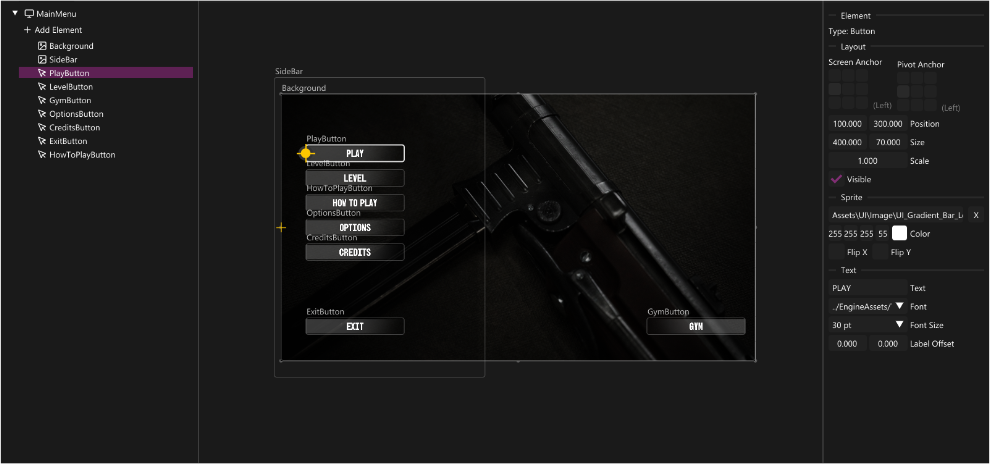
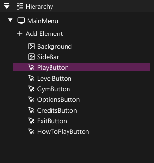
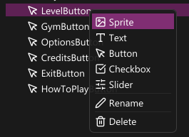
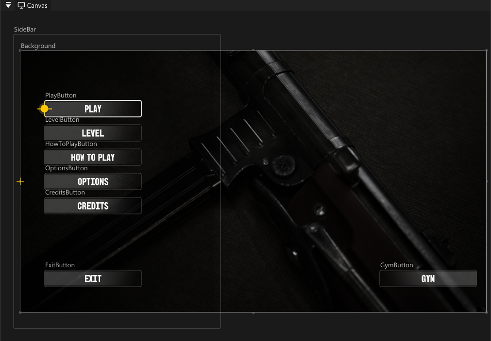
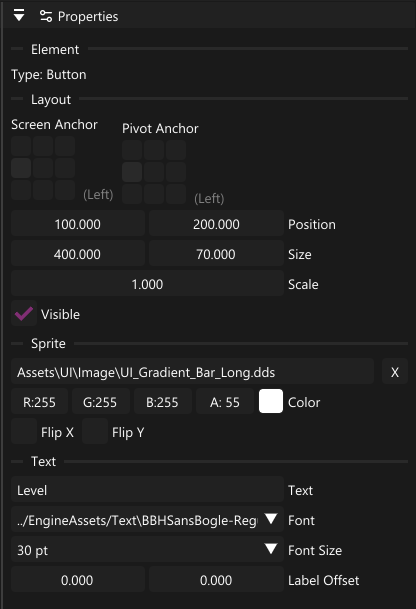

## Introduction

With the introduction of the Tools course I got the idea to improve the UI system I began working on during project 5. During the said project I laid out the base with basic functionality for displaying Text, Sprite and Button elements, with the caveat that it all must be hardcoded by a programming. This included the functions like placement, scale, visuals etc.

*Code Example*

```cpp
std::shared_ptr<UIButtonElement> menuButton = std::make_shared<UIButtonElement>();

menuButton->SetResolution(myResolution);

menuButton->SetScreenAnchor(UIAnchor::Center);
menuButton->SetPivotAnchor(UIAnchor::Center);

menuButton->SetTexture("Assets/UI/Buttons/UI_Button.dds");
menuButton->SetToTextureSize();
menuButton->SetScale(0.35f);

menuButton->SetPivotMargin({0.f, 100.f - 25.f});

menuButton->SetLabelText("Main Menu");
menuButton->SetLabelFont("Text/KELMSCOT.TTF");
menuButton->SetLabelFontSize(Tga::FontSize_18);
    
    
menuButton->SetOnClick([]
{
    Singletons::GetLevelHandler().LoadLevel("levels/L_Menu_scene.tgs");
    Singletons::GetStateStackPtr()->PushState(StateType::MainMenu);
});

myElements.push_back(menuButton);
```

While this did work, it ended up being a tedious workflow. Every little change from the Artists would require me to pause my current task and verify all the assets and layouts.

After pushing trough with the current workflow during Project 5 I decided that for the next project I will be creating a better solution for this problem. During the Tools course we got the opportunity to pick whatever type of tool we would like to create, that's when I decided to do it.

## Chapter 1: The Idea & The Editor

The idea was simple, build a visual interface for editing UI while keeping it simple to use and maintain in the long run for me and fellow programmers. Thanks to my work in on our game editor I've come to pickup few ideas for structuring up this tool.

Main flow would be : A simple graphical interface based on Godot's UI Editor, build the UI visually, save the data in a json file and lastly have a way to simply load the data in the game with the use of pre-existing UI system.

## Execution

<!--  -->

Above can you see the full view of the UI Editor. It consists of the components,

- **Hierarchy**: where you can see all elements in the scene

- **Canvas**: where you get a visual representation of of the UI

- **Properties**: where you can see selected elements properties

### Hierarchy

The Hierarchy supports most basic features, such as reordering of the elements, creation of new elements, renaming as well as deletion.

<!--  -->

<!--  -->

### Canvas

The Canvas emulates a 2D viewport where it creates the actual UI Elements. The reason for this solution is that at first I attempted to create the elements using Dear ImGui , which though looking similar and being more performant did not scale or behave the same as the UI elements in the game. Resulting in mismatch of colours, positions, sizes and many more, making the Editor effectively useless. Hence the solution of creating the elements in editor as well, this way I could assure most accurate representation of the menus.

<!--  -->

Here are some behind the scenes code snippets on the UI in the editor

With the use of inheritance we can simply create a base element with all generic functions that other elements will have.

***Base Element***

```cpp
std::unique_ptr<UIBaseElement> element = CreateRuntimeElement(aNode);
if (!element)
    return;

UIBaseElement* elementPtr = element.get();
const Tga::UIElementProperties& p = aNode.props;

elementPtr->SetParent(aParent);
elementPtr->SetVisible(p.visible);
elementPtr->SetScreenAnchor(static_cast<UIAnchor>(p.screenAnchor));
elementPtr->SetPivotAnchor(static_cast<UIAnchor>(p.pivotAnchor));
elementPtr->SetPosition({ p.position.x, p.position.y });
elementPtr->SetPivotMargin({ p.pivotMargin.x, p.pivotMargin.y });
elementPtr->SetSize({ p.size.x , p.size.y } );
elementPtr->SetID(aNode.id);
elementPtr->SetResolution(aCanvasSize);
```

and then we could do some custom stuff depending on the type of node

***Sprite Element***

```cpp
if (auto* sprite = dynamic_cast<UISpriteElement*>(elementPtr))
{
	if (!p.texturePath.empty())
		sprite->SetTexture(p.texturePath.c_str());

	sprite->SetColor({ p.color.x, p.color.y, p.color.z, p.color.W });
	sprite->SetScale(p.scale);
	sprite->SetRotation(p.rotation);
	sprite->FlipX(p.flipX);
	sprite->FlipY(p.flipY);
	sprite->SetType(static_cast<SpriteType>(p.spriteType));
	sprite->SetFillAmount(p.fillAmount);
	sprite->SetFillDirection(static_cast<FillDirection>(p.fillDirection));
	sprite->SetFillAlign(static_cast<FillAlign>(p.fillAlign));
}
```

***Text Element***

```cpp
if (auto* text = dynamic_cast<UITextElement*>(elementPtr))
{
	text->SetText(p.text);
	text->SetFontSize(static_cast<Tga::FontSize>(p.fontSize));

	if (!p.fontPath.empty())
		text->SetFont(p.fontPath.c_str());

	text->SetColor({ p.color.x, p.color.y, p.color.z, p.color.W });
	text->SetScale(p.scale);
	text->SetPivotMargin({ p.labelOffset.x, p.labelOffset.y });
}
```

This way we ensure the most accurate result in both.

### Properties

The Properties take the most inspiration from both Unity and Godot in terms of how they are presented, short and simple naming convention and such with layered output. The top of the properties will always be the base that is common for all elements, then sprite, text and lastly buttons.

***The Button element is a combination of all 3 elements***

<!--  -->

## Saving Format

Lastly, the way we save this data is by saving it in a vector to json. Keeping it fast to load due to the entire menu being able to be saved to a single file, making it readable and technically editable without the editor if that would be ever needed.

```json
{
"children": [],
"id": 1,
"name": "PlayButton",
"props": {
	"canvasSize": [
		1920.0,
		1080.0
	],
	"checkedColor": [
		1.0,
		1.0,
		1.0,
		1.0
	],
	"checkedTexturePath": "",
	"color": [
		1.0,
		1.0,
		1.0,
		0.21568627655506134
	],
	"fillAlign": 0,
	"fillAmount": 1.0,
	"fillDirection": 0,
	"flipX": false,
	"flipY": false,
	"fontPath": "../EngineAssets/Text\\BBHSansBogle-Regular.ttf",
	"fontSize": 30,
	"labelOffset": [
		0.0,
		0.0
	],
	"pivotAnchor": 8,
	"pivotMargin": [
		0.0,
		0.0
	],
	"position": [
		100.0,
		300.0
	],
	"rotation": 0.0,
	"scale": 1.0,
	"screenAnchor": 8,
	"size": [
		400.0,
		70.0
	],
	"spriteType": 0,
	"text": "PLAY",
	"texturePath": "Assets\\UI\\Image\\UI_Gradient_Bar_Long.dds",
	"toggled": false,
	"uncheckedColor": [
		1.0,
		1.0,
		1.0,
		1.0
	],
	"visible": true
},
"type": 3
},
```

## Editor Summary

With this approach we make it easy to edit and fix the UI on the go with minimal input from anyone besides the person doing the UI themselves.

In short we: Create elements in the editor, we lay them out as we wish and lastly save them to a json file for future use in game.

## Chapter 2 : In Game

Now that we have the Menu created and styled to our liking it is time to get it working in game, as previously shown in the old workflow, it is rather inefficient to write everything out by hand. We need a simple, easy and of course reliable solution to not only load the UI in the game, but also be able to manage it and edit it in game code based on need, whether it's ammo count, pop up window or any use whatsoever.

Since I have felt the pain of hardcoding this I wanted to be able to load it in as few lines as possible.

Similarly loading the saved menu in editor we use a **UIObjectLoader** . It takes in the file path to the desired menu, loops trough it and stores the newly created elements in an unordered map,

```cpp
class UIObjectLoader
{
public:
	struct LoadResult
	{
		std::unique_ptr<UIBaseElement> root;
		std::unordered_map<std::string, UIBaseElement*> elementsByName;
		std::vector<std::unique_ptr<UIBaseElement>> allElements;

		template<typename T>
		T* GetElement(const std::string& aName)
		{
			auto it = elementsByName.find(aName);
			if (it != elementsByName.end())
				return dynamic_cast<T*>(it->second);
			return nullptr;
		}

		std::unordered_map<std::string, UIBaseElement*>& GetElementsByName();

		std::vector<UIBaseElement*> GetAllElements();
	};


	static LoadResult Load(const std::string& aFilePath, Tga::InputManager* aInputManager = nullptr);

private:
	UIObjectLoader() = default;
};
```

With this setup when we wish to load a menu in a level we can simply call it like this :

```cpp
auto result = rhe::UIObjectLoader::Load("Assets/UI/MainMenu.uitgo", inputManager);
```

using the stored result we are able to do stuff like this to change behaviour of elements like buttons without having to recreate them from scratch, but simply push new changes on already made element.

```cpp
if (auto* button = result.GetElement<UIButtonElement>("PlayButton"))
{
	button->SetOnClick([]()
	{
		Singletons::GetStateStackPtr()->PushState(StateType::DifficultySelect);
	});
	button->SetOnHover([]()
   {
	   Singletons::GetEventManager().SendMsg(EventBank::ButtonHover());
   });
}
```

## Summary

The UI Editor turned a tedious, all-hardcoded workflow into a visual authoring tool — artists and designers can now lay out menus independently without programmer involvement for every tweak.

The two-part system keeps concerns cleanly separated: the editor handles visual composition and serializes layouts to `.uitgo` JSON files, while `UIObjectLoader` handles runtime loading in as few as one line. Game code only needs to reach in via `GetElement()` to wire up behaviour like click handlers, leaving the visual layout entirely in the editor's hands.
