## Tools

I draw everything in **Affinity Designer**.

## Carving shapes

Most of my drawing is shape carving: building a piece out of simple shapes and cutting them down until they turn into something. I picked up the term from **Scott Flanders**, who also showed me how much can be done with just the basics.
<!-- To link him: [Scott Flanders](https://link-to-his-page) -->

I started out with basic shapes like circles, squares and triangles, moving them around and recolouring them. Slowly I learned how vector art actually works, and began moving the nodes around to make more interesting shapes. Eventually I could make the more complex ones in one go with the pen tool.

I used to draw from the small details out. Now I start from the silhouettes and slowly build the piece up, going back and forth as I go. The focus is always on **colours** and **simple shapes**.

<!-- A stand-in animation. To show a recording of your own carving instead, put it in
     the process/ folder and point this at it (an animated .gif or .webp works) -->

*Carving a horn out of a circle.*

## Two styles

I switch between two distinct styles:

- **Flat lines**, with straight lines and hard angles.
- **Smooth lines**, with soft curves and rounded edges.

**Flat lines** are my favourite to make. I love seeing how far I can push them while keeping them minimal. I haven't seen the style around, so it feels personal, like something I developed just for myself.

**Smooth lines** were always there, and they're easier for me to make. I do find them fun, and it's nice seeing something playful and soft come together, but they can't replace flat lines in my heart.

[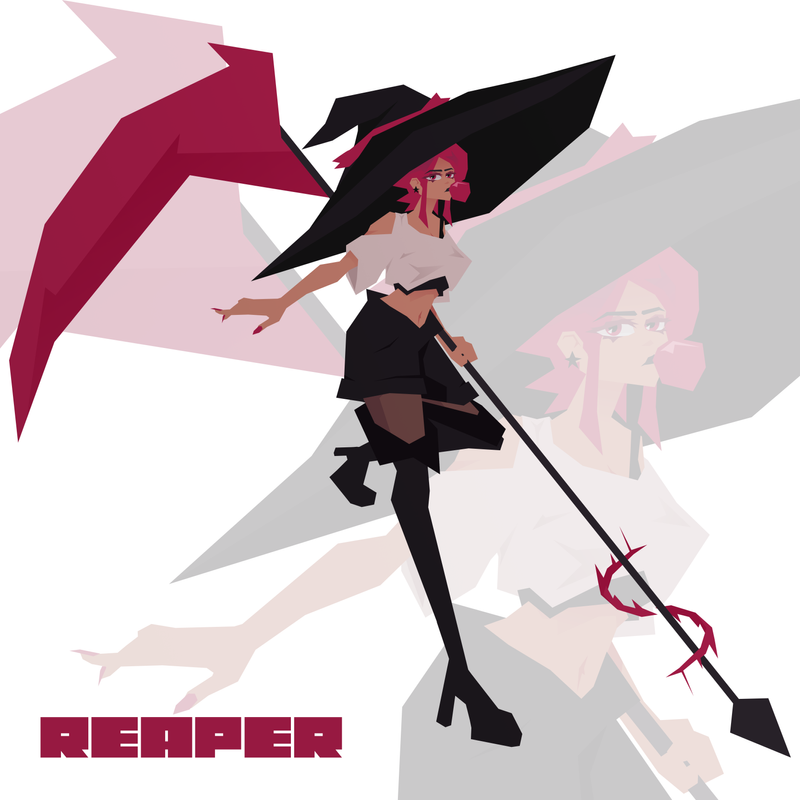](/art/172) [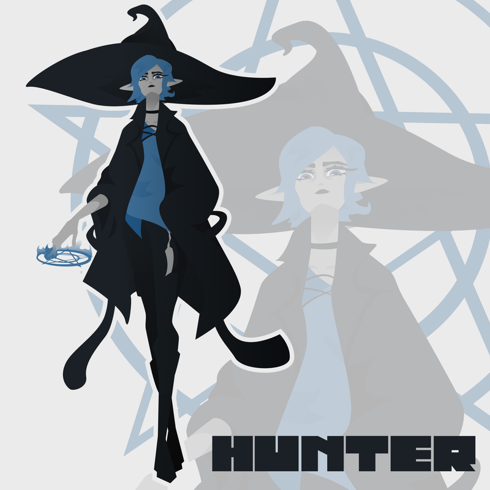](/art/169)

*Flat lines on the left (Battle Witch), smooth lines on the right (Magic Huntress).*

## Finishing touches

My personal take on extras and rendering:

- **A multiply layer and a gradient layer on top**, with lowered opacity, to even out all the colours.
- **Outlines**, sometimes.
- **A faded copy of the character in the background**, to fill up the empty space.
- **Overlay textures**, like lines and dots.

<!--  -->

My go-to fonts are **Cubic** and **Luckiest Guy** (the one all over this site).

## Where I started

Designer didn't start out as an art tool for me. I first got it for work, designing cutting sheets for a laser cutter, sewing sheets, patterns and lots more. Slowly I started trying to make art with it too, and made it work.

My early pieces were all over the place: I drew whatever I could imagine, always focusing on the colours. Most of it was bust-up characters or just heads, along with creatures and all sorts of other things.

I started out with smooth lines. Flat lines came naturally as I drew more and tried more stuff, since I've always been drawn to simplicity. Over time I also moved over to drawing female characters, because I found drawing their hair and outfits so much fun.

[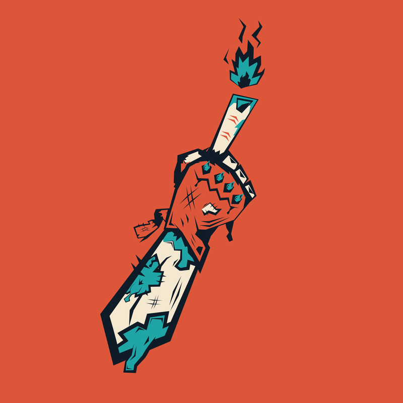](/art/3) [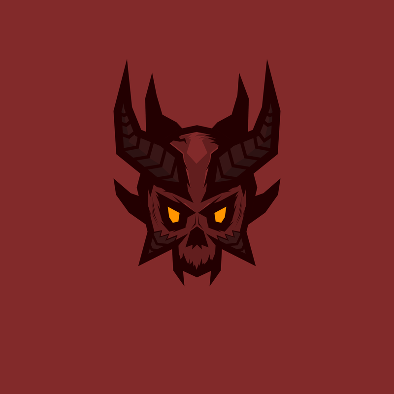](/art/5) [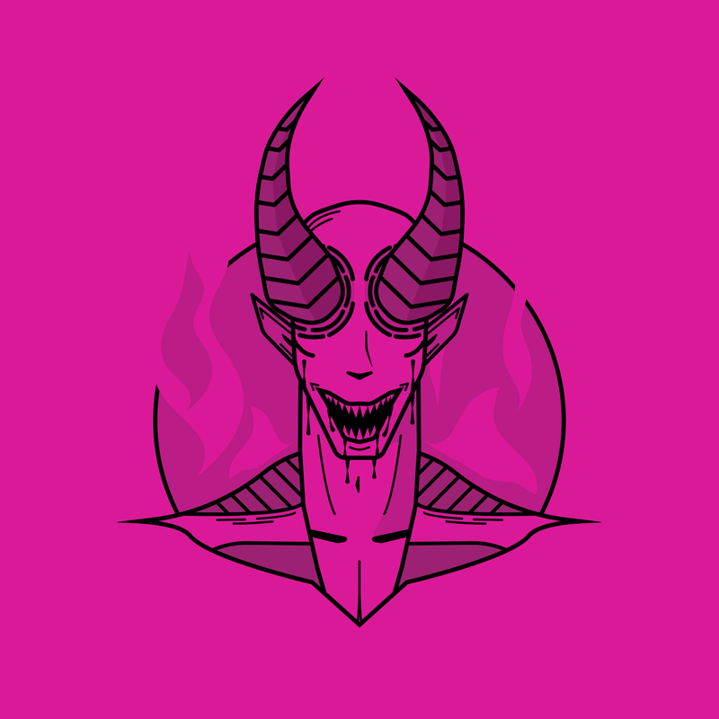](/art/10)

*Some of my early pieces.*

## Growing with Quil

Quil is my first ever OC: the first character I drew more than once, and still the only one with a name.

She started as a fun challenge, a piece where I limited my palette to four colours. In the end I loved the colour combo and the design, and bit by bit I expanded on her. The name came from that original file, called something like `QuickLimitedPalette`. My friend FireKS suggested "Quil", and it's stuck ever since.

I even know her blue by heart: `#31c5d1`. Probably one of my top 3 colours.

My favourite parts of her design are the horns, the elf-style ears and the eyes. A pale demon who's playful, fun and outgoing just clicks.

Whenever I feel like I've levelled up my skills, I end up drawing her, so lined up over time, Quil shows the slow progression of my art. She'll keep growing alongside me and reach new heights.

[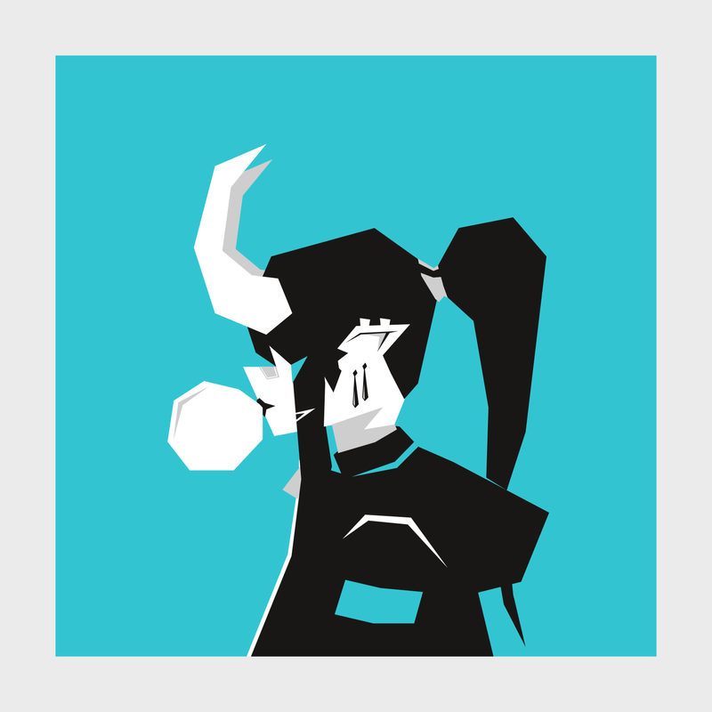](/art/57) [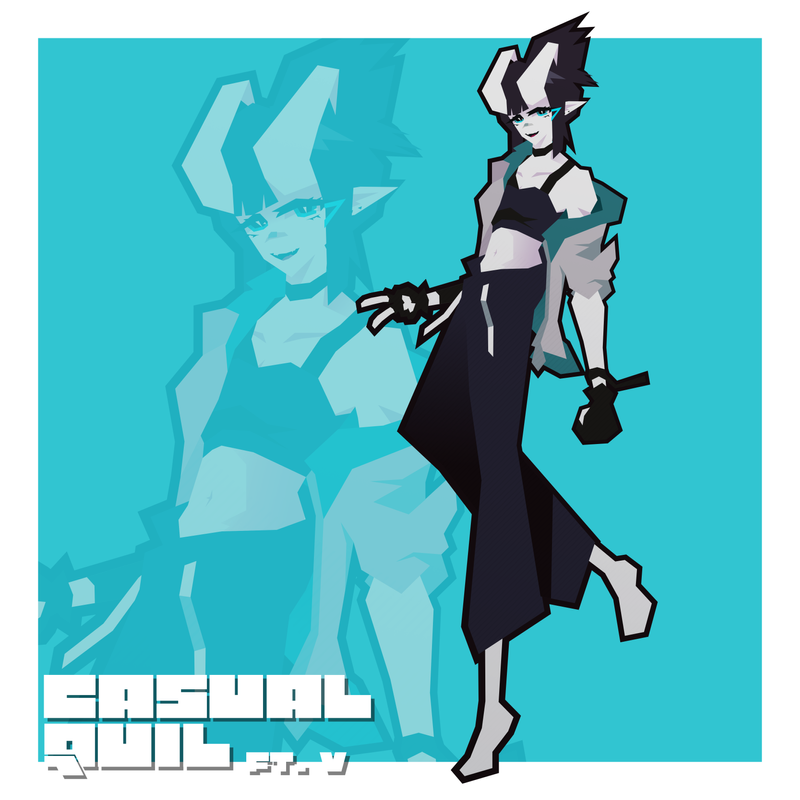](/art/147) [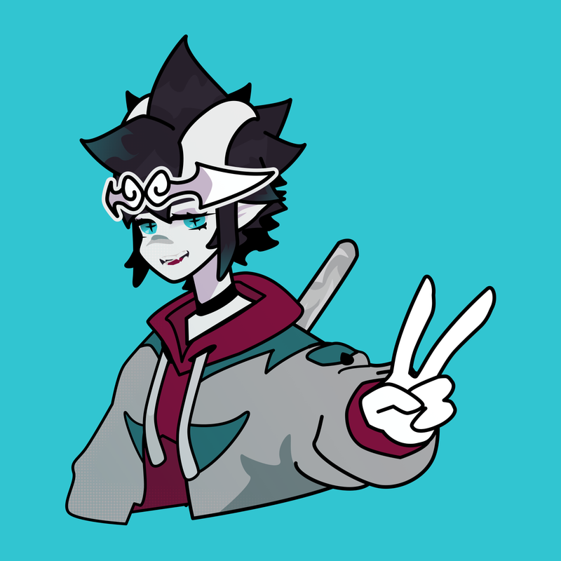](/art/177)

*Quil, oldest to newest: the four-colour original, then Casual Quil and Cosplay Quil.*

## Redraws

I love redrawing my older pieces. It lets me compare my skills and creativity with my old self, instead of comparing myself to others.

Open one of these and hit **Then & now** to slide between it and the original. In the [gallery](/#gallery-scene), redraws carry a little *redraw* stamp.

[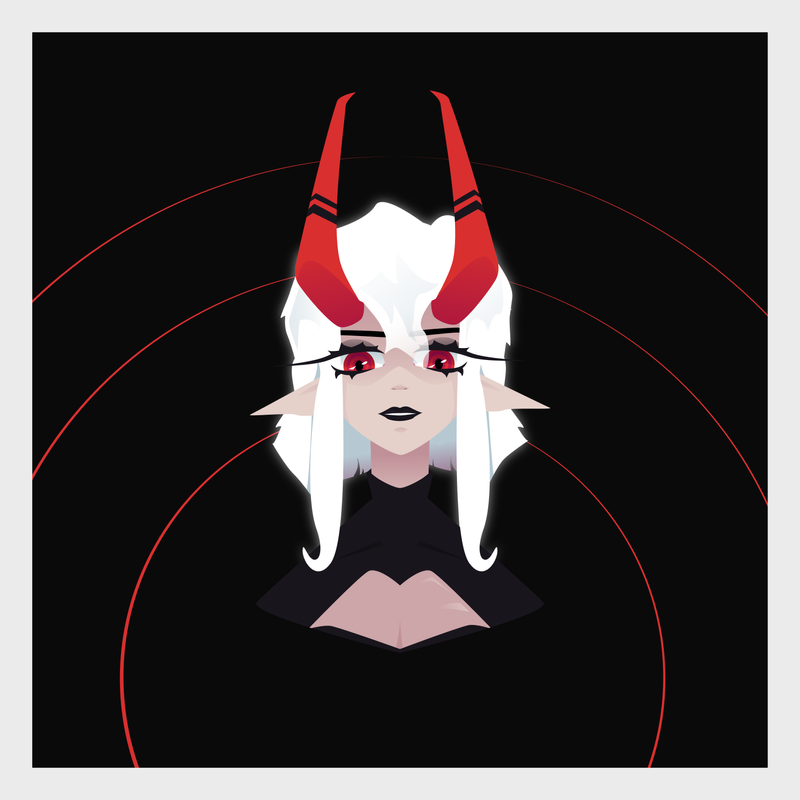](/art/176) [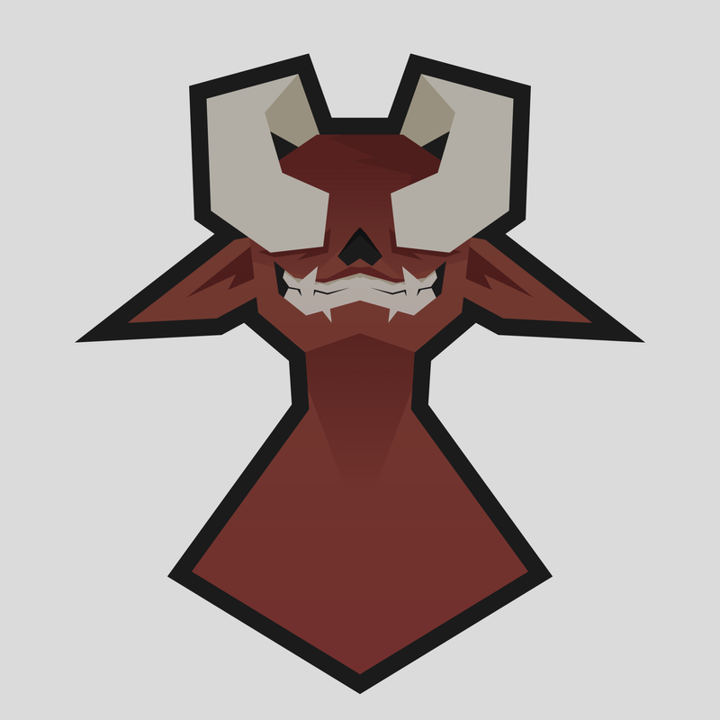](/art/174) [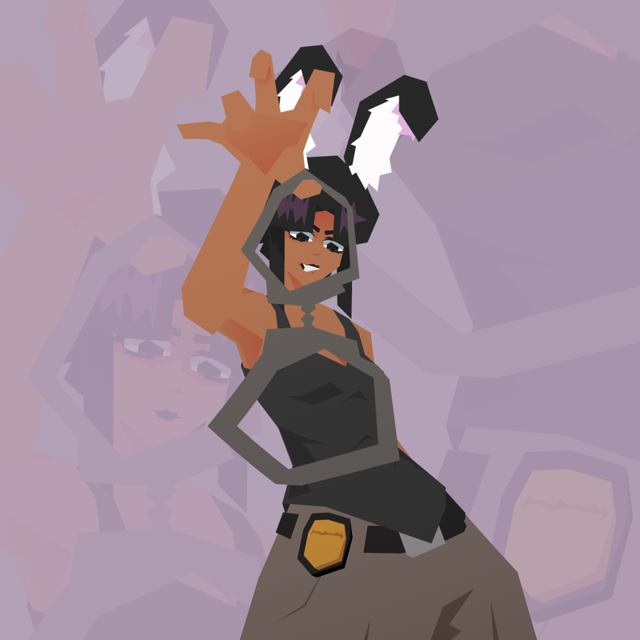](/art/162)

*Redraws: Red Gaze, Red Devil and Bunny Cop Remaster.*

## Inspiration

I pull from a lot of places: anime, manga, webtoons, and other artists. A few whose work I love:

- **X:** [@Daikei_625](https://x.com/Daikei_625), [@MRN0093](https://x.com/MRN0093), [@dijor98](https://x.com/dijor98), [@GomeyTheAndroid](https://x.com/GomeyTheAndroid)
- **ArtStation:** [leicai](https://www.artstation.com/leicai), [sevenseven](https://www.artstation.com/sevenseven), [jieke007](https://www.artstation.com/jieke007)
- **Instagram:** [@guywhodoesart](https://www.instagram.com/guywhodoesart)
